# Práctica 1.1 · Instalación de la pila LAMP en AWS

**Despliegue de Aplicaciones Web · Curso 2026/2027**
**Alumno:** Fran · GitHub: [Frxnker](https://github.com/Frxnker)

En esta práctica se automatiza con scripts de Bash la instalación de una pila **LAMP** (Linux, Apache, MySQL y PHP) sobre una instancia EC2 de AWS con Ubuntu Server, junto con varias herramientas adicionales: **phpMyAdmin**, **Adminer**, **GoAccess** y control de acceso con **.htaccess**.

---

## Índice

1. [Arquitectura](#1-arquitectura)
2. [Creación de la instancia en AWS](#2-creación-de-la-instancia-en-aws)
3. [Estructura del repositorio](#3-estructura-del-repositorio)
4. [Variables de configuración (.env)](#4-variables-de-configuración-env)
5. [Instalación de Apache, PHP y MySQL](#5-instalación-de-apache-php-y-mysql)
6. [Instalación de phpMyAdmin](#6-instalación-de-phpmyadmin)
7. [Instalación de Adminer](#7-instalación-de-adminer)
8. [Instalación de GoAccess](#8-instalación-de-goaccess)
9. [Control de acceso con .htaccess](#9-control-de-acceso-con-htaccess)
10. [Cómo reproducir el despliegue](#10-cómo-reproducir-el-despliegue)

---

## 1. Arquitectura

Se utiliza una **arquitectura web con un único servidor**: Apache, PHP y MySQL se ejecutan en la misma máquina.

| Ventajas | Inconvenientes |
|---|---|
| Sencilla de implementar y mantener | Todos los servicios compiten por los mismos recursos |
| Adecuada para aplicaciones con poca carga | No permite escalar horizontalmente, solo verticalmente (más CPU/RAM) |

---

## 2. Creación de la instancia en AWS

Desde el laboratorio de **AWS Academy** se ha creado una instancia EC2 con estas características:

| Parámetro | Valor |
|---|---|
| Región | `us-east-1` (Norte de Virginia) |
| AMI | Ubuntu Server 26.04 LTS |
| Par de claves | `vockey` |
| Grupo de seguridad | `launch-wizard-5` |
| IP elástica | `18.235.210.235` |

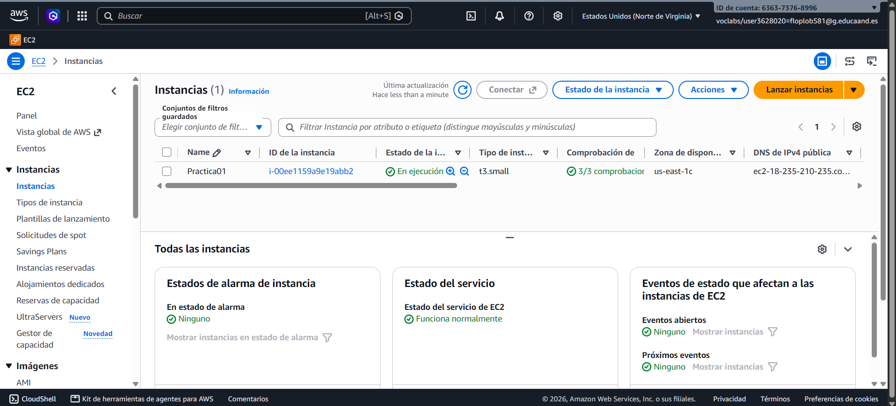

### IP elástica

Se ha reservado una IP elástica y se ha asociado a la instancia, para que la dirección pública no cambie al detener y arrancar la máquina.

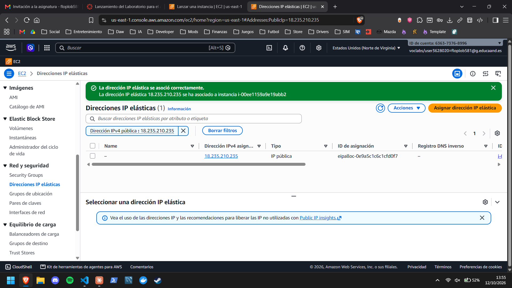

### Grupo de seguridad

Reglas de entrada configuradas:

| Puerto | Protocolo | Uso |
|---|---|---|
| 22 | TCP | SSH |
| 80 | TCP | HTTP |
| 443 | TCP | HTTPS |
| 7890 | TCP | WebSocket del informe en tiempo real de GoAccess |

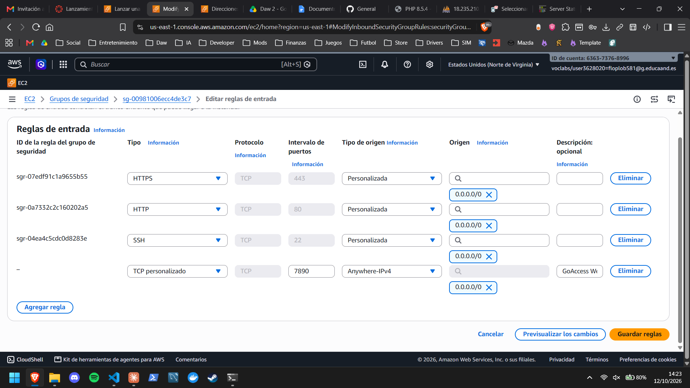

### Conexión por SSH

Desde PowerShell en Windows:

```powershell
ssh -i vockey.pem ubuntu@18.235.210.235
```

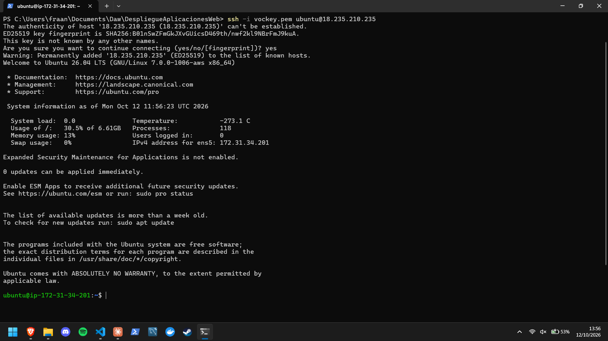

---

## 3. Estructura del repositorio

```
.
├── README.md
├── .gitignore
├── conf
│   └── 000-default.conf
├── htaccess
│   └── .htaccess
├── img
├── php
│   └── index.php
└── scripts
    ├── .env.example
    ├── install_lamp.sh
    └── install_tools.sh
```

| Archivo | Función |
|---|---|
| `conf/000-default.conf` | VirtualHost de Apache. Prioriza `index.php` y permite `.htaccess` en `/stats` |
| `htaccess/.htaccess` | Autenticación básica para el directorio `/stats` |
| `php/index.php` | Página de prueba con `phpinfo()` |
| `scripts/install_lamp.sh` | Instala Apache, PHP y MySQL |
| `scripts/install_tools.sh` | Instala phpMyAdmin, Adminer, GoAccess y configura `.htaccess` |
| `scripts/.env.example` | Plantilla de variables de configuración |

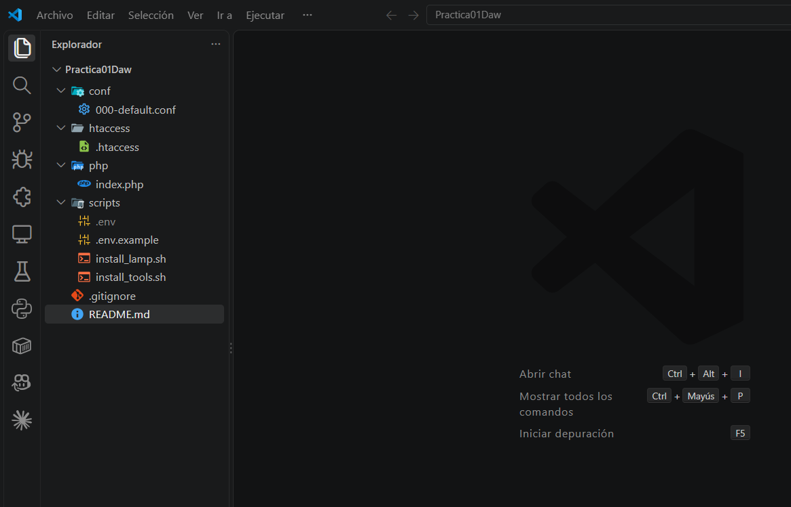

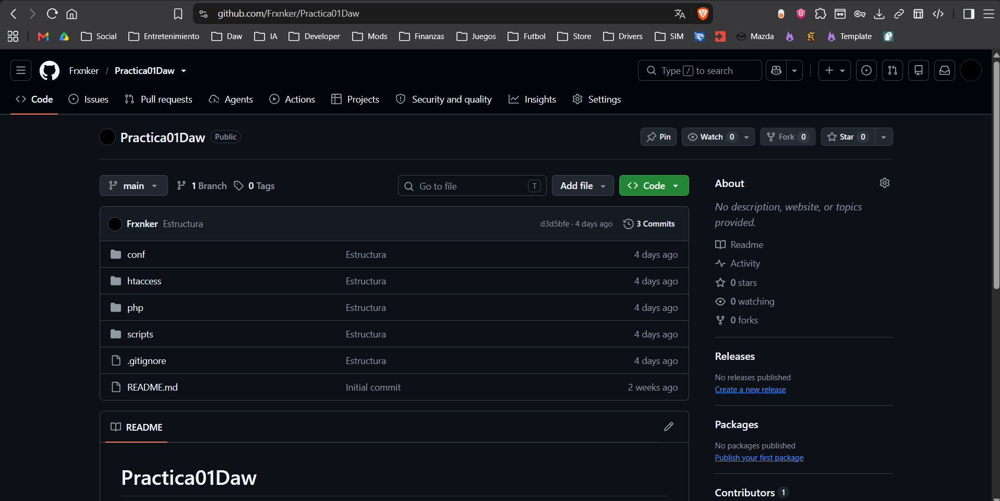

---

## 4. Variables de configuración (.env)

Las contraseñas y usuarios no se escriben dentro de los scripts, sino en un archivo `scripts/.env` que los scripts cargan con `source .env`.

Como el `.env` contiene información sensible, **no se sube al repositorio**: está incluido en `.gitignore`. En su lugar se sube `.env.example` con las variables vacías:

```
PHPMYADMIN_APP_PASSWORD=
APP_USER=
APP_PASSWORD=
STATS_USERNAME=
STATS_PASSWORD=
```

| Variable | Uso |
|---|---|
| `PHPMYADMIN_APP_PASSWORD` | Contraseña interna de la aplicación phpMyAdmin |
| `APP_USER` / `APP_PASSWORD` | Usuario de MySQL para entrar en phpMyAdmin y Adminer |
| `STATS_USERNAME` / `STATS_PASSWORD` | Credenciales para acceder a `/stats` |

Para comprobar que los nombres del `.env` coinciden con los que usan los scripts:

```bash
grep -oh '\$[A-Z_]*' install_tools.sh install_lamp.sh | sort -u
```

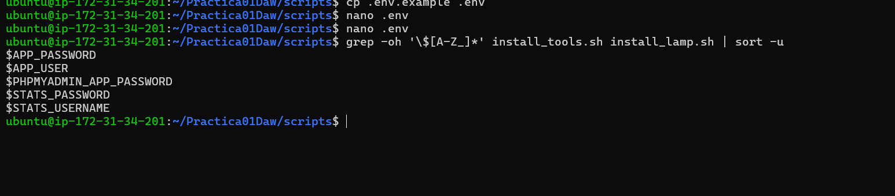

---

## 5. Instalación de Apache, PHP y MySQL

Script: `scripts/install_lamp.sh`

Pasos que realiza:

1. Actualiza los repositorios y los paquetes del sistema (`apt update` y `apt upgrade`).
2. Instala **Apache** (`apache2`) y habilita el módulo `rewrite`.
3. Copia el VirtualHost `conf/000-default.conf` a `/etc/apache2/sites-available/`.
4. Instala **PHP** junto con el módulo de Apache y la extensión de MySQL (`php`, `libapache2-mod-php`, `php-mysql`).
5. Instala **MySQL Server**.
6. Copia `php/index.php` a `/var/www/html/` y asigna el propietario `www-data`.

Se usan `DEBIAN_FRONTEND=noninteractive` y `set -ex` para que la instalación no pida confirmaciones, muestre cada comando y se detenga si alguno falla.

En la instancia se clona el repositorio y se crea el `.env` a partir de la plantilla:

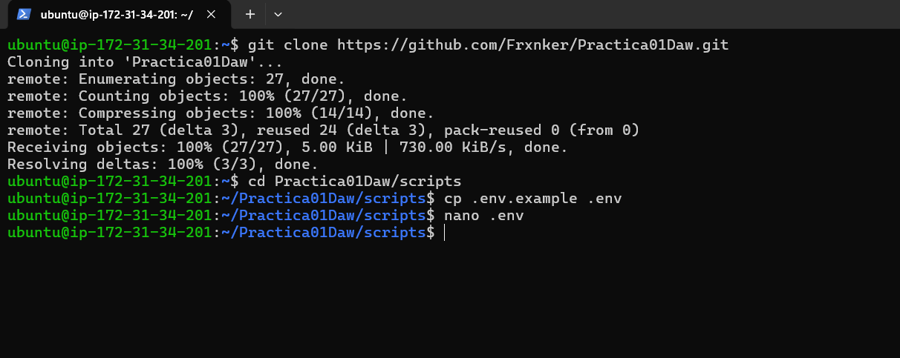

Ejecución:

```bash
cd Practica01Daw/scripts
chmod +x *.sh
sudo ./install_lamp.sh
```

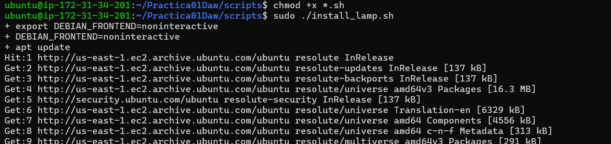

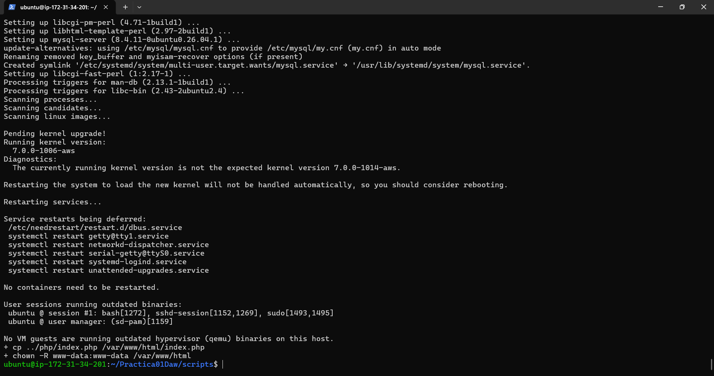

Al acceder a `http://18.235.210.235` se muestra la página de `phpinfo()`, lo que confirma que Apache interpreta PHP correctamente. Versiones instaladas: **Apache 2.4.66**, **PHP 8.5.4** y **MySQL 8.4.11**.

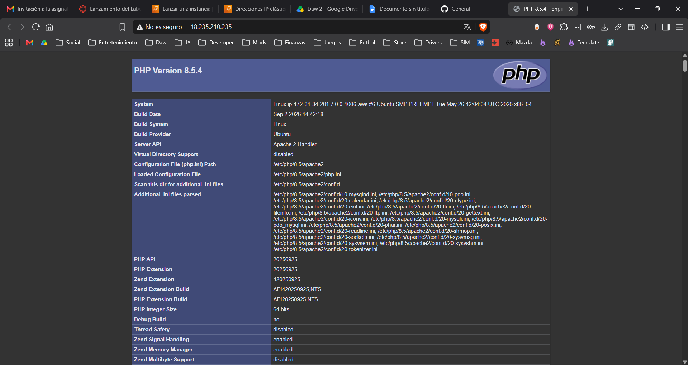

---

## 6. Instalación de phpMyAdmin

Script: `scripts/install_tools.sh`

phpMyAdmin pregunta varias cosas durante su instalación. Para automatizarlo, las respuestas se configuran antes con `debconf-set-selections`:

```bash
echo "phpmyadmin phpmyadmin/reconfigure-webserver multiselect apache2" | debconf-set-selections
echo "phpmyadmin phpmyadmin/dbconfig-install boolean true" | debconf-set-selections
echo "phpmyadmin phpmyadmin/mysql/app-pass password $PHPMYADMIN_APP_PASSWORD" | debconf-set-selections
echo "phpmyadmin phpmyadmin/app-password-confirm password $PHPMYADMIN_APP_PASSWORD" | debconf-set-selections
```

Después se instala el paquete junto con las extensiones de PHP que necesita, y se crea un usuario de MySQL con los valores de `APP_USER` y `APP_PASSWORD` para poder iniciar sesión:

```bash
mysql -u root <<< "CREATE USER '$APP_USER'@'%' IDENTIFIED BY '$APP_PASSWORD'"
mysql -u root <<< "GRANT ALL PRIVILEGES ON *.* TO '$APP_USER'@'%'"
```

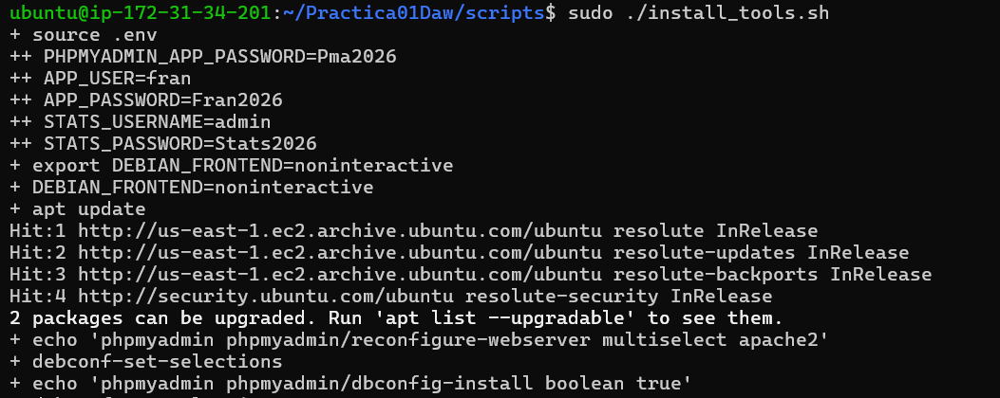

Acceso: `http://18.235.210.235/phpmyadmin`

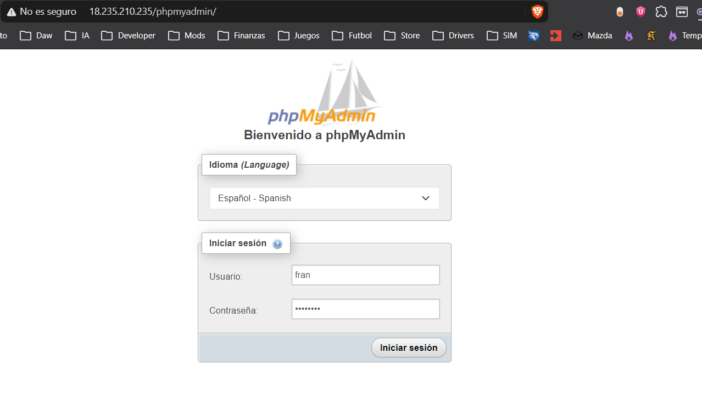

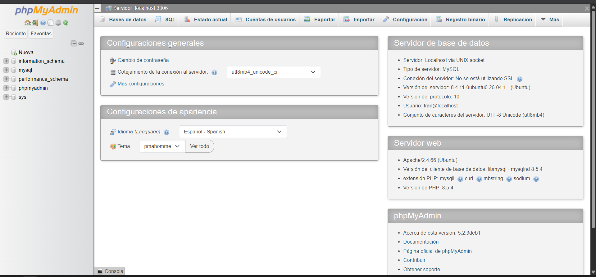

---

## 7. Instalación de Adminer

Adminer es una alternativa ligera a phpMyAdmin que consiste en un único archivo PHP. El script crea el directorio `/var/www/html/adminer` y descarga en él Adminer como `index.php`.

Acceso: `http://18.235.210.235/adminer`, con motor **MySQL**, servidor **localhost** y el usuario de `APP_USER`.

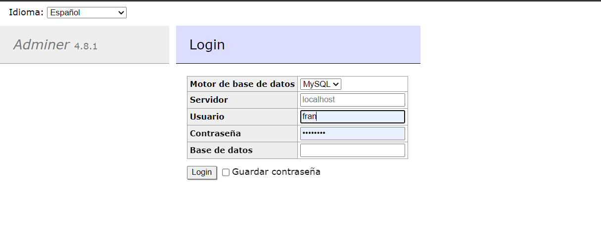

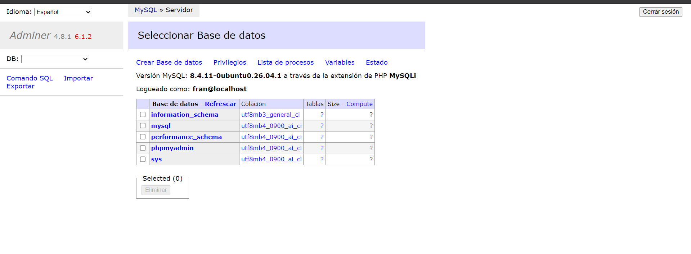

---

## 8. Instalación de GoAccess

GoAccess es un analizador de logs que genera un informe HTML a partir del `access.log` de Apache.

```bash
apt install goaccess -y
mkdir -p /var/www/html/stats
goaccess /var/log/apache2/access.log -o /var/www/html/stats/index.html \
         --log-format=COMBINED --real-time-html --daemonize
```

| Opción | Significado |
|---|---|
| `-o` | Archivo HTML de salida |
| `--log-format=COMBINED` | Formato de log que usa Apache |
| `--real-time-html` | El informe se actualiza en tiempo real mediante un WebSocket |
| `--daemonize` | GoAccess se queda ejecutándose en segundo plano |

### Problema encontrado

Al abrir `/stats` por primera vez apareció el mensaje *UNABLE TO AUTHENTICATE WEBSOCKET*.

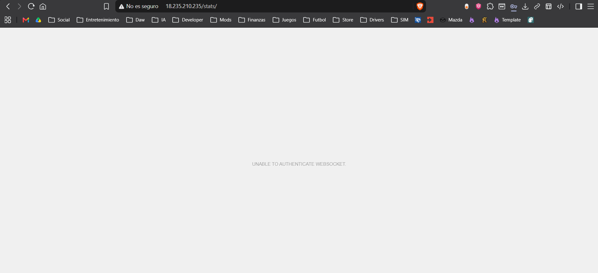

**Causa:** el informe en tiempo real se comunica con el servidor a través del **puerto 7890**, que no estaba abierto en el grupo de seguridad.

**Solución:** añadir una regla de entrada TCP 7890 desde `0.0.0.0/0` (ver [grupo de seguridad](#grupo-de-seguridad)). Tras ello el panel carga y se actualiza solo (el punto verde junto al icono de ajustes indica que el WebSocket está conectado).

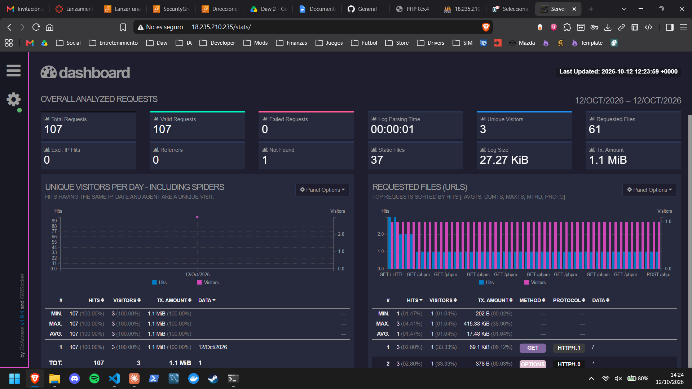

---

## 9. Control de acceso con .htaccess

El directorio `/stats` se protege con **autenticación básica** de Apache.

**1. Permitir `.htaccess` en ese directorio**, en `conf/000-default.conf`:

```apache
<Directory "/var/www/html/stats">
    AllowOverride All
</Directory>
```

**2. Crear el archivo de contraseñas** con el usuario de `STATS_USERNAME`:

```bash
htpasswd -bc /etc/apache2/.htpasswd $STATS_USERNAME $STATS_PASSWORD
```

**3. Copiar el `.htaccess`** al directorio protegido:

```apache
AuthType Basic
AuthName "Acceso restringido"
AuthBasicProvider file
AuthUserFile "/etc/apache2/.htpasswd"
Require valid-user
```

```bash
cp ../htaccess/.htaccess /var/www/html/stats/
systemctl restart apache2
```

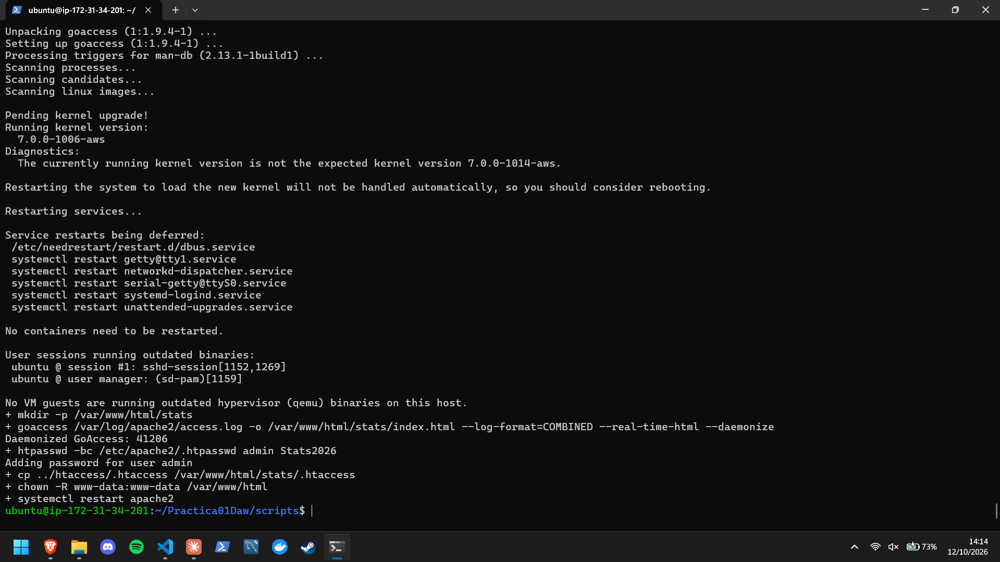

Al acceder a `http://18.235.210.235/stats` el navegador pide usuario y contraseña antes de mostrar el informe:

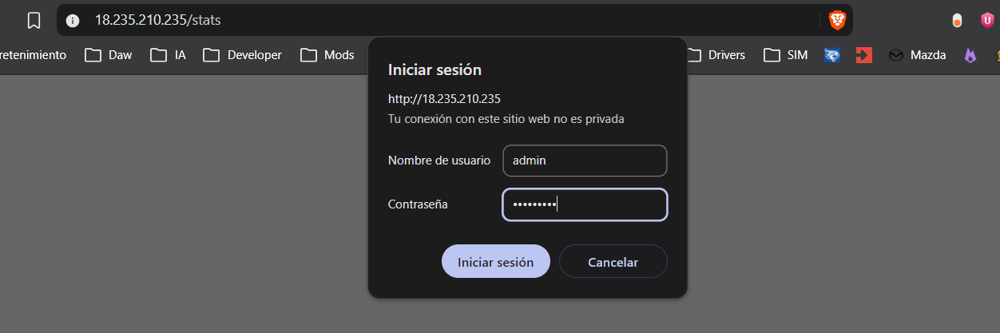

---

## 10. Cómo reproducir el despliegue

En una instancia Ubuntu Server con los puertos 22, 80, 443 y 7890 abiertos:

```bash
git clone https://github.com/Frxnker/Practica01Daw.git
cd Practica01Daw/scripts
cp .env.example .env
nano .env                 # rellenar las variables
chmod +x *.sh
sudo ./install_lamp.sh
sudo ./install_tools.sh
```

| URL | Contenido |
|---|---|
| `http://IP` | `phpinfo()` |
| `http://IP/phpmyadmin` | phpMyAdmin |
| `http://IP/adminer` | Adminer |
| `http://IP/stats` | Informe de GoAccess (protegido) |

> **Nota:** los scripts usan rutas relativas (`../conf`, `../php`, `../htaccess`), así que deben ejecutarse desde dentro de la carpeta `scripts`.

---

## Referencias

- [Enunciado de la práctica](https://josejuansanchez.org/daw/practica-01-01/index.html)
- [Apache HTTP Server](https://httpd.apache.org/)
- [phpMyAdmin](https://www.phpmyadmin.net/)
- [Adminer](https://www.adminer.org/)
- [GoAccess](https://goaccess.io/)
- [Tutorial de Apache: ficheros .htaccess](https://httpd.apache.org/docs/2.4/es/howto/htaccess.html)
